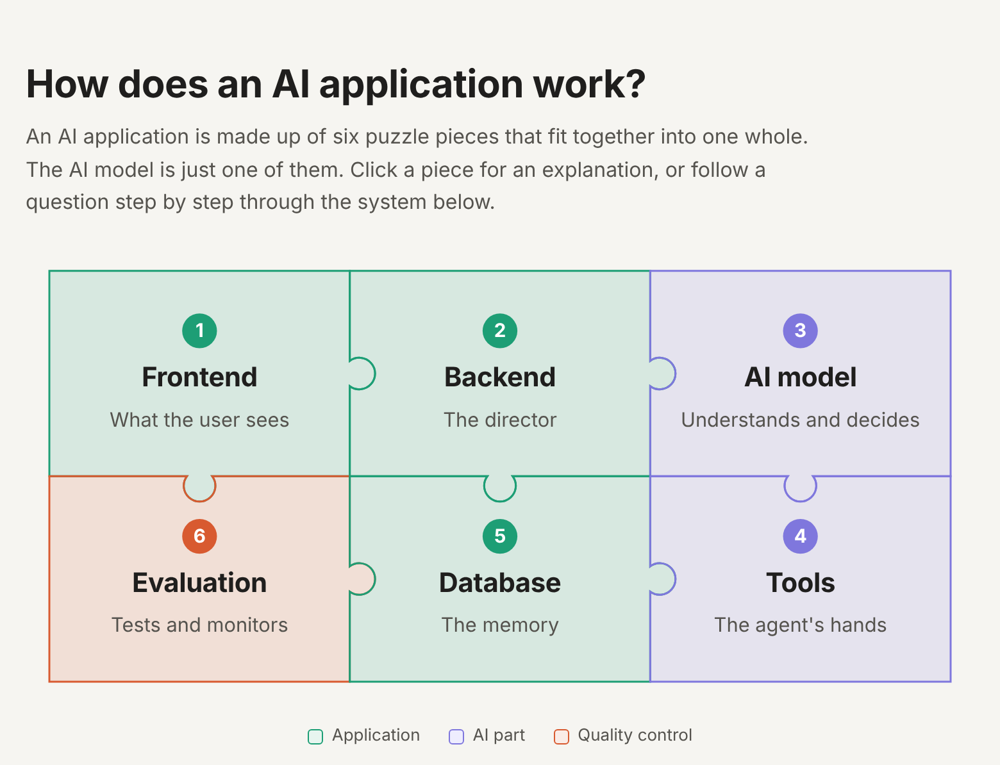
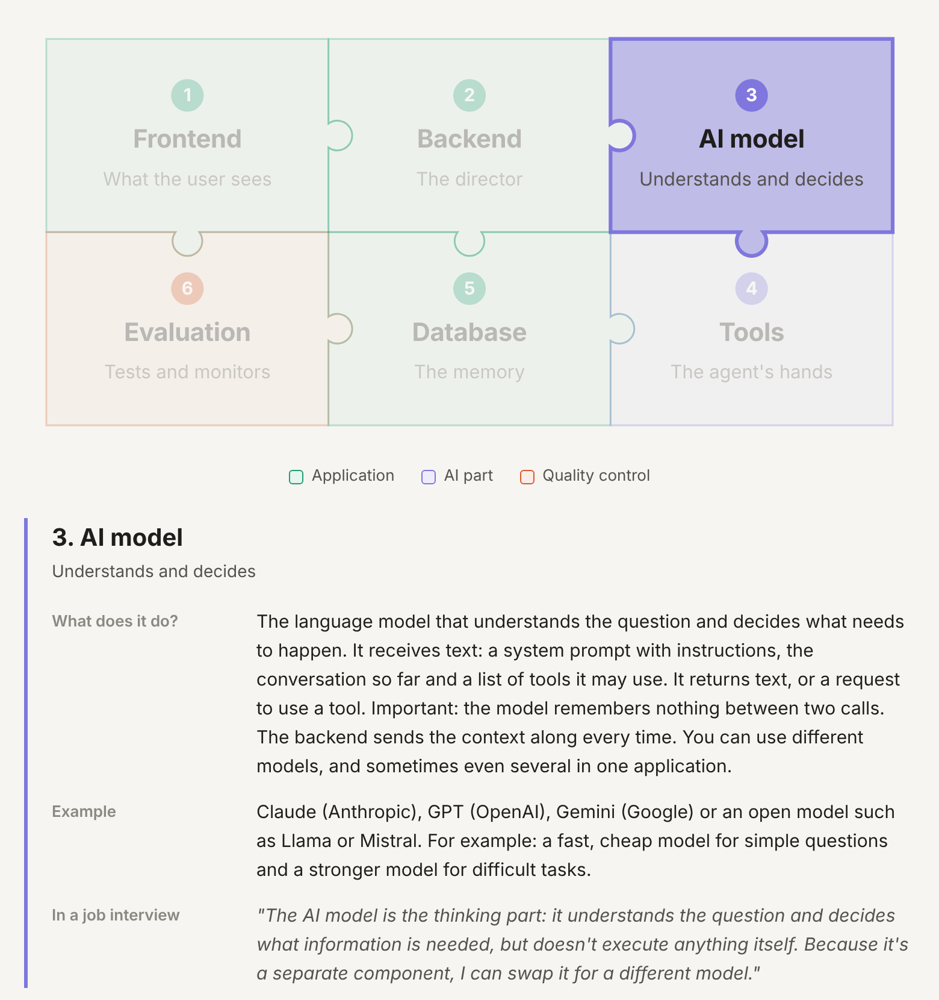
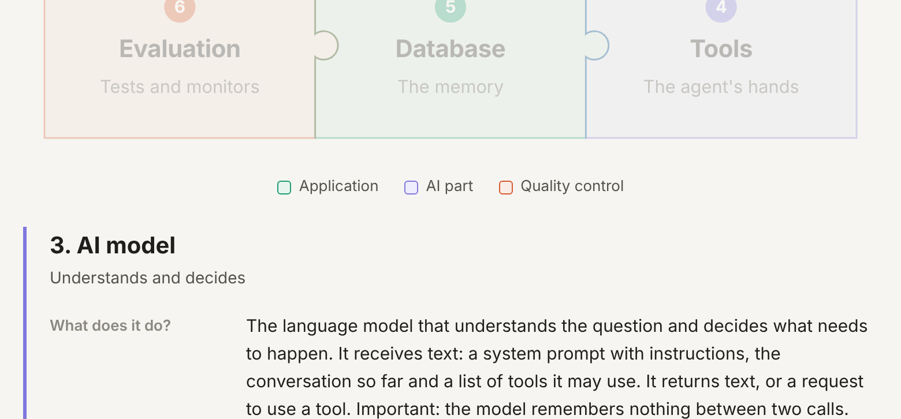

# AI system puzzle

**An interactive, visual explanation of how an AI application is built: six puzzle pieces that only work together.**

[**▶ Open the live page**](https://sylvievvv.github.io/ai-system-puzzle/)

## Why this project?

Many people think an AI application *is* the AI model. In reality the model is just one piece. A working application also needs a frontend, a backend that coordinates everything, tools that let the model take action, a database that remembers things, and evaluation to check that it all works reliably.

I made this page to understand that architecture myself, and to be able to explain it clearly, for example in a job interview for an AI agent developer role.

## The six pieces

| # | Piece | Role | Example |
|---|-------|------|---------|
| 1 | **Frontend** | What the user sees: collects input and shows the answer | Chat window, dashboard, Discord bot |
| 2 | **Backend** | The director: coordinates every other piece and keeps the API key safe | Python (FastAPI, Flask) or Node.js |
| 3 | **AI model** | Understands the question and decides what's needed, but executes nothing itself | Claude, GPT, Gemini, Llama, Mistral |
| 4 | **Tools** | The agent's hands: functions the model can ask the backend to run | Webshop API, web search, sending an email |
| 5 | **Database** | The memory: the model remembers nothing between calls, so this does | PostgreSQL, SQLite, a vector database for RAG |
| 6 | **Evaluation** | Tests and monitors whether the system answers correctly and handles errors | Test questions, logging, error handling |

## Click a piece for the details

Each piece explains what it does, gives a concrete example, and offers one sentence you can use to explain it in a job interview.

## Follow a question through the system

The second part of the page follows one customer question, *"Why hasn't my order shipped yet?"*, through six steps. At every step the pieces that are working light up:

1. **Frontend:** the user types the question.
2. **Backend and database:** the backend checks the user and fetches customer data.
3. **Backend and AI model:** the model reads the question and asks for the `get_order_status` tool.
4. **Backend and tools:** the backend actually runs the tool. Result: *awaiting payment*.
5. **AI model:** the model writes a clear answer.
6. **Frontend and evaluation:** the user sees the answer, and the conversation is logged.

## Key takeaway

> The AI model is the thinking part, but the backend is the director. It decides what information the model gets and what actually gets executed.

## How to use it

- **Online:** open the [live page](https://sylvievvv.github.io/ai-system-puzzle/).
- **Locally:** download `index.html` and open it in any browser. No installation, build step or internet connection needed.

## Built with

Plain HTML, CSS and JavaScript, with an inline SVG for the puzzle. No frameworks or libraries.
